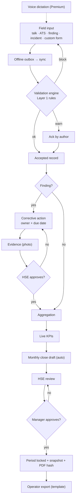

# Vaquia — Technical Overview

> HSE management platform for oilfield service SMEs in the Neuquén basin (Vaca Muerta).
> v3.0 · October 2026. Supersedes v2.x and `plataforma-hse-neuquen.md` v1.1.
>
> Human-facing reference. Claude does not load this file during development; it works from `docs/spec/` and the current phase file. Plain-language walkthrough: `docs/COMO-SE-USA.md`.

---

## 1. Purpose

Service companies (20–300 employees) must produce a constant stream of HSE records and report KPIs to the operators they work for (YPF, PAE, Tecpetrol, Pluspetrol, Vista). Today they do it with Excel, PDF, WhatsApp and paper.

Vaquia turns every field record into data that moves up the chain on its own:

1. Validated at capture.
2. Escalated when something is wrong.
3. Aggregated into KPIs.
4. Closed monthly.
5. Delivered in the operator's format.

There is a human approval at each level and an immutable audit trail.

## 2. Roles

| Role | Surface | Main actions |
|---|---|---|
| `worker` | Field (mobile) | Signs records; reports findings and incidents |
| `supervisor` | Field, often offline | Toolbox talks, ATS, signatures, evidence for own crew's actions |
| `hse` | Office + field | Reviews records, manages findings/actions, qualifications, man-hours, monthly close draft |
| `manager` | Office | Dashboards, approves monthly close |
| `admin` | Office | Company config, crews, users, **form schemas**, rules, export templates, billing |
| `staff` | Internal (Vaquia) | Manual billing, support. Outside tenant RLS, separate auth, every action audited |

`personas` (payroll) ≠ `users` (login). Roles live on `memberships` (user × company).

## 3. Data chain



### 3.1 Record lifecycle
`draft → pending_sync → submitted → (blocked | accepted) → reviewed → locked`

- `draft` and `pending_sync` exist on the device only (IndexedDB).
- The server is authoritative. The client runs the same rules for instant feedback only.
- `locked`: the period was approved. A locked record is never edited; corrections are new records with `amends_record_id`.
- A record that syncs late but is dated inside a locked period goes to a "pendiente de enmienda" queue. It never lands silently in the closed month.

### 3.2 Corrective action lifecycle
`open → in_progress → pending_approval → closed`. A rejection sends it back to `in_progress` with a comment. `overdue` is derived, never stored.

### 3.3 Period lifecycle
`open → closing → in_review → pending_approval → approved → exported`

## 4. Record types and form schemas

Every field input is a **record** with `type`, `schema_version` and a `payload jsonb`. Queryable columns (date, crew, location, author, task type, status) are typed.

### 4.1 Built-in types
| Type | Who | Notes |
|---|---|---|
| `toolbox_talk` | Supervisor | Topic, attendees, signatures, geo + timestamp |
| `ats` | Supervisor + crew | Steps → hazards → controls, PPE checklist, signatures |
| `finding_report` | Anyone | Description, photo (required), location, suggested severity → creates a `finding` |
| `incident_report` | Anyone | Quick report; HSE classifies later (near miss, first aid, recordable, LTI, fatal, environmental) |

### 4.2 Company-defined types (phase 3b)
Admins create their own forms and reports without code: inspections, checklists, specific permits, internal reports.

- **Builder fields:** text, number, date/time, select, multi-select, checkbox, photo, signature, persona picker, crew/location picker, repeatable group.
- **Extensions:** add company fields to built-in types (e.g. an extra question in the toolbox talk) without forking them.
- **Field rules:** required, conditional visibility, ranges/patterns, "requires signature of", "creates finding if…". They compile to Layer 1 rules (§5) and are evaluated identically on client and server.
- **Versioning:** every publish creates an immutable `form_schema` version and retires the previous one. Records keep and render with the version they were filled with. Drafts on a retired version still sync for 7 days (spec/forms.md).
- **Runtime:** the schema JSON produces a Zod validator and the form UI at runtime, with offline support via cached schemas. Drafts started on an old version can be submitted against that version.
- **Downstream:** export templates (A3) reference custom fields by type code + key; custom fields can be filtered in the records list. KPIs use built-in data plus fields tagged with a fixed list of KPI inputs.
- **Gate:** `has_feature('custom_forms')` (Pro and up).

## 5. Validation engine

| Layer | What | When | Max severity |
|---|---|---|---|
| 1 Deterministic | Missing signatures, signer without valid required qualification, required items unchecked, schema field rules | MVP (phases 3, 3b) | `block` |
| 3 Semantic (LLM) | Hazards mentioned but not controlled; text contradicts checklist; repeated "sin novedad" | Phase 9 (Premium) | `warn` — **an LLM never blocks** |
| 2 Statistical | Per-crew outliers | Post-pilot | `warn` |
| 4 Correlations | Clusters (e.g. 3 near misses at one location in 72 h) | Post-pilot | `info` |

**Non-negotiables:**
- Every alert explains what and why.
- A false positive can be flagged in one click.
- Every evaluation is logged append-only: rule version, input hash, output. LLM calls also log prompt version, model, cost and latency.
- Rules are versioned.

## 6. Automations

| ID | What | Trigger | Output |
|---|---|---|---|
| **A1** | Qualification expiry | Daily 06:00 ART | One digest per recipient (30/15/7/0 d). At 0 days the persona is blocked from tasks that require the qualification |
| **A2** | Monthly close | `report_day` (default 1st) | Draft with KPIs, incidents, actions, qualifications and trend, plus a completeness checklist. On approval: snapshot + lock + hashed PDF |
| **A3** | Operator export | Manual, approved periods only | XLSX/CSV/PDF from versioned declarative templates, generated from the snapshot, stored with hash |
| Escalation | Overdue actions, blocked records, pending approvals | Hourly | Per the escalation table in `spec/workflow.md` |

Notifications go to the in-app inbox (always), email (Resend) and web push. Every notification has a dedupe key and is never sent twice.

## 7. Voice + AI (Premium, phase 9)

Voice is available for **every field input**: toolbox talk, ATS (split into steps, hazards and controls), finding report, incident report, and the closure evidence of a corrective action.

- Audio is captured offline and transcribed server-side after sync.
- An LLM fills a **draft of the existing form**, using the same schema and validator. The user always reviews and confirms; nothing is submitted automatically.
- Layer 3 semantic warnings run on the confirmed record.
- Eval set: at least 10 labeled samples per input type before release. Precision is tracked.
- Gate: `has_feature('voice_ai')`.

## 8. Plans and billing

Fixed monthly subscription per company. Annual billing = 2 months free. **All prices are placeholders to validate in discovery.**

| | Base | Pro | Premium |
|---|---|---|---|
| Monthly / annual (USD) | 149 / 1,490 | 349 / 3,490 | 699 / 6,990 |
| Active field users | 25 | 100 | Unlimited |
| Crews | 5 | 20 | Unlimited |
| Includes | Capture, qualifications + A1, actions, basic KPIs | + A2, A3 (1 template), custom forms, full KPIs | + unlimited templates, voice + AI, priority support |

- Optional one-time paid onboarding (placeholder USD 500).
- Record history is never limited by tier, because HSE records must be retained.
- **Entitlements:** `has_feature()` and `within_limit()` (SQL + TS). The server always enforces; the UI shows locked features as disabled.
- **Subscription states:** `trialing → active → past_due → canceled`, plus `paused`. The trial gets Pro entitlements.
- **Non-payment:** 7-day grace period, then read-only. Exports and PDFs always stay available, and offline captures still sync during grace.
- **Over limit:** adding new users or crews is blocked. Existing ones are never deactivated automatically.
- **Payment:** manual (bank transfer against invoice, marked paid by `staff`) in phase 1c. Automated via Mercado Pago Suscripciones in phase 8b, to be confirmed by research. Stripe is likely unavailable to an Argentine entity without a foreign company (unverified).
- Electronic invoicing (ARCA) is out of scope for now.

## 9. Architecture

```
PWA (Next.js on Vercel)
 ├─ (office)  dashboards, review, config, form builder
 ├─ (field)   capture, offline → Dexie outbox + cached schemas/reference data
 └─ server actions / route handlers → Supabase
        ├─ Postgres + RLS (company_id on every tenant row)
        ├─ Storage (private buckets, signed URLs)
        ├─ pg_cron → Edge Functions (A1, A2, escalation, notifications)
        ├─ SQL views (KPIs)
        └─ append-only tables (triggers reject UPDATE/DELETE)
External: Resend · Web Push · Mercado Pago (8b) · STT + Claude API (9)
```

| Concern | Choice |
|---|---|
| Framework | Next.js 16, React 19, TypeScript strict, pnpm |
| UI | Tailwind v4 + tokens, shadcn/ui restyled. Greys + teal accent, grain background, light/dark |
| Schemas | Zod (built-in) + runtime Zod from `form_schemas` (custom) |
| Offline | Serwist + Dexie. UUIDv7 client IDs, idempotent upserts, blobs before records, conflict copies, never delete local data before server confirms |
| Rules | json-logic-js, same evaluator client/server |
| Docs | @react-pdf/renderer, exceljs |
| Tests | Vitest, Playwright, `supabase test db`. `[test-now]` on silent-failure cores, full suite at end of phase |
| Hosting | Vercel (Pro required once billing customers) + Supabase (region to confirm with pilot) |

**Append-only tables:** `audit_log`, `rule_evaluations`, `notifications`, `period_snapshots`, `exports`, `billing_events`, `llm_invocations`.

**Signatures:** *firma electrónica* (Ley 25.506). Stores signer, timestamp, geo and a hash of the signed content. Operator acceptance is still to be confirmed.

## 10. Data model (summary)

Full detail in `spec/data-model.md`.

| Area | Tables |
|---|---|
| Tenancy | `companies`, `memberships` |
| People & places | `personas`, `crews`, `locations`, `operators` |
| Qualifications | `qualification_types`, `qualifications`, `task_types`, `task_requirements` |
| Forms | `record_types`, `form_schemas` (versioned; base + extension) |
| Records | `records`, `record_participants`, `signatures`, `attachments` |
| Validation | `rules` (versioned), `rule_evaluations`, `alert_feedback`, `audit_log` |
| Findings | `findings`, `corrective_actions` |
| KPIs & close | `man_hours`, `incidents`, `periods`, `period_snapshots` |
| Export | `export_templates` (versioned), `exports` |
| Notifications | `notifications`, `push_subscriptions` |
| Billing | `plans` (versioned), `subscriptions`, `payments`, `billing_events` |
| AI | `prompt_templates`, `llm_invocations` |

## 11. Roadmap

| # | Phase | Status |
|---|---|---|
| 0 | Foundations: auth, tenancy, RLS, design system, CI | done |
| 1 | People, crews, locations, qualifications | done |
| 1b | Self-serve sign up, onboarding, trial | doing |
| 1c | Plans, entitlements, manual billing | todo |
| 2 | Field capture: toolbox talk + ATS, offline, signatures | todo |
| 3 | Validation engine (Layer 1) + audit | todo |
| 3b | Company forms: builder, extensions, field rules | todo |
| 4 | Findings (incl. standalone report) + corrective actions | todo |
| 5 | A1 expiry alerts + notifications | todo |
| 6 | Man-hours, incidents, KPIs | todo |
| 7 | A2 monthly close | todo |
| 8 | A3 operator export | todo |
| 8b | Automated payments (Mercado Pago) | todo |
| 9 | Voice + LLM for all field inputs (Premium) — post-pilot | todo |

**Business track:**
- Before phase 2: 15–20 discovery interviews; pick the pilot company and its operator.
- Phases 2–4: the pilot uses capture in the field.
- After phase 8: first paid contracts.

## 12. Risks

| Risk | Mitigation |
|---|---|
| Long B2B sales cycle | Target owner-run SMEs; self-serve trial |
| Operators reject on-screen signatures | Validate early; fallback: photo of the paper sheet attached to the record |
| Man-hours unavailable | Simple monthly input; KPIs show "incompleto" instead of guessing |
| Offline sync loses data | Outbox, idempotent IDs, `[test-now]` + airplane-mode e2e |
| Custom forms break KPIs or exports | Versioned schemas; KPIs only use explicitly tagged fields; export mapping validated per template version |
| Alert fatigue | Digests, dedupe, severity discipline, false-positive button |
| Liability for missed alerts | ToS ("supports, does not replace, the HSE professional"), versioning, immutable logs |

## 13. Open questions

1. What is the pilot operator's exact report format? Get a real filled example (blocks phase 8).
2. Where do man-hours come from today?
3. Does the operator accept *firma electrónica* for ATS and permits?
4. Which channel do supervisors read: email, push or WhatsApp? WhatsApp costs per message.
5. KPI base (200k vs 1M HH) and the operator's definition of "recordable".
6. Who approves the monthly report at the pilot?
7. Pricing: USD reference vs fixed ARS; willingness to pay per tier; card vs transfer; who pays.
8. Data residency requirements.

## 14. Repo map

| File | For |
|---|---|
| `CLAUDE.md` | Claude's rules (loaded every session) |
| `docs/PLAN.md` | Phase index + status |
| `docs/phases/phase-X.md` | One phase: tasks, agents, acceptance |
| `docs/spec/*.md` | Single-topic specs Claude reads per phase |
| `docs/OVERVIEW.md` | This document |
| `docs/COMO-SE-USA.md` | Plain-language walkthrough (Spanish) |
