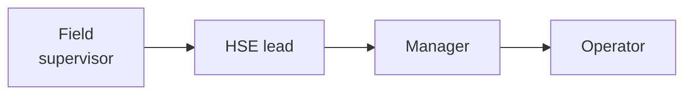

# Vaquia — Overview

> HSE platform for oilfield service SMEs in the Neuquén basin (Vaca Muerta).
> v2.1 · October 2026 · Full restart. Supersedes `plataforma-hse-neuquen.md` v1.1.
>
> **Human-facing document.** Claude does not read this file during development. Technical specs live in `docs/spec/`.

---

## 1. Problem

Oilfield service SMEs (20–300 employees) produce a constant stream of mandatory HSE records — toolbox talks, ATS, permits, inspections — and report KPIs to the operators they work for (YPF, PAE, Tecpetrol, Pluspetrol, Vista). Today this runs on Excel, PDF, WhatsApp and paper. The consequences:

- Supervisors spend hours on paperwork.
- Every record gets loaded twice: once in the internal sheet, once in the operator's format.
- Expired qualifications go unnoticed until an audit or an accident.
- The monthly report costs the HSE lead 4 to 6 hours of manual consolidation.

## 2. Goal

Every field record becomes data that flows up the chain automatically: validated at capture, escalated when something is wrong, aggregated into KPIs, and delivered to the operator. There is a human approval at each level and an immutable audit trail.

**Three headline automations:**
1. **Qualification expiry alerts.** Nobody with an expired qualification signs an ATS.
2. **Automatic monthly report.** The month closes into a draft, gets reviewed and approved, and is frozen.
3. **Operator export.** The approved month goes out in the operator's exact format, with no retyping.

## 3. What changed vs v1.1

| v1.1 | v2 |
|---|---|
| Anchor: AI anomaly engine | Anchor: data chain + 3 automations. AI comes later. |
| Voice in the MVP | Voice post-pilot (phase 9) |
| 4 detection layers planned up front | Layer 1 in the MVP; Layers 2–4 when data and demand exist |
| Data model missing qualifications, periods and audit tables | Fixed (`spec/data-model.md`) |
| Colorful UI | Minimal, color only carries meaning |

## 4. Scope

**MVP (phases 0–8):**
- Tenancy and roles.
- People, crews and qualifications.
- Offline capture of toolbox talks and ATS, with signatures.
- Layer 1 validation.
- Corrective actions.
- Man-hours, incidents and KPIs.
- A1, A2 and A3.

**Post-MVP:**
- Voice and LLM.
- More record types: permits, LOTO, inspections, observation cards, investigations.
- Map.
- Statistical and correlation layers.
- Operator APIs.

**Out of scope:** native apps, payroll/HR, operational daily reports.

## 5. Business model

- Monthly SaaS priced per active field user or per crew, with an annual discount.
- Paid onboarding for the first customers: loading people and qualifications, and setting up the operator template.
- Premium tier later: voice + AI.

**Pitch (to validate in discovery, not assume):**
- Fewer supervisor hours on paperwork.
- Monthly report goes from hours to minutes.
- No expired qualification ever signs.
- The operator report is ready the day the month closes.

## 6. Roadmap

| Phase | Content |
|---|---|
| 0 | Foundations |
| 1 | People and qualifications |
| 2 | Offline field capture |
| 3 | Validation engine |
| 4 | Corrective actions |
| 5 | A1 expiry alerts |
| 6 | KPIs |
| 7 | A2 monthly report |
| 8 | A3 operator export |
| 9 | Voice + AI (post-pilot) |

**Business track:**
- Before phase 2: run 15–20 discovery interviews; pick the pilot company and its operator.
- Phases 2–4: the pilot uses capture in the field.
- After phase 8: first paid contracts.
- At about 12 months: decide between bootstrapping, raising capital, or expanding to Mendoza/Chubut.

**Company setup:**
- Incorporate a SAS with the first customer.
- Sign a partners' agreement with vesting.
- Don't leave the current job until there are 6–9 months of runway or an anchor customer.

## 7. Risks

| Risk | Mitigation |
|---|---|
| Long B2B sales cycle | Target owner-run SMEs with a single decision-maker |
| Operators reject on-screen signatures | Validate in discovery; fall back to a photo of the paper sheet attached to the record |
| Man-hours not reliably available | Simple monthly input per crew; KPIs show "incompleto" instead of guessing |
| Offline sync loses data | Outbox, idempotent IDs, e2e tests with the network toggled |
| Alert fatigue | Digests, dedupe, severity discipline, false-positive button |
| Liability for missed alerts | ToS ("supports, does not replace, the HSE professional"), versioning, immutable logs |
| Dependence on a single operator | Template-based export from day one |

## 8. Open questions (answer in discovery)

1. Which operator does the pilot report to, and what is its exact format? Get a real filled example.
2. Where do man-hours come from today?
3. Does that operator accept an on-screen signature (*firma electrónica*, Ley 25.506) for ATS/PT?
4. Which channel do supervisors actually read: email, push or WhatsApp? WhatsApp has a per-message cost.
5. Which KPI base does the operator use (200k vs 1M HH), and how does it define "recordable"?
6. Who approves the monthly report at the pilot?
7. Is there a data residency requirement?

## 9. Repo map

| File | For |
|---|---|
| `CLAUDE.md` | Claude's rules (loaded every session) |
| `docs/PLAN.md` | Phase index + status |
| `docs/phases/phase-X.md` | One phase: tasks, agents, acceptance |
| `docs/spec/workflow.md` | Roles, states, escalation |
| `docs/spec/automations.md` | A1, A2, A3 |
| `docs/spec/rules-engine.md` | Detection layers + non-negotiables |
| `docs/spec/architecture.md` | Stack, offline sync, security |
| `docs/spec/data-model.md` | Tables |
| `docs/spec/domain.md` | Record types, KPIs, qualifications, legal |
| `docs/spec/design.md` | UI tokens and rules |
